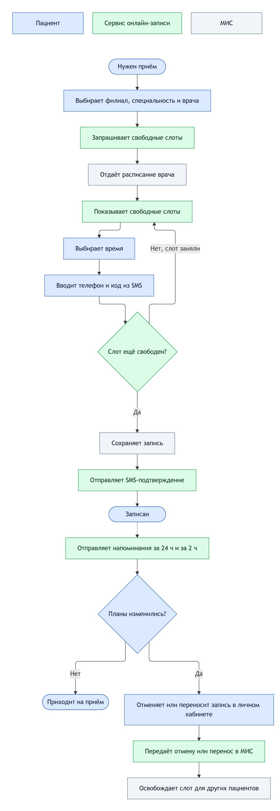

# Бизнес-кейс: онлайн-запись в сеть клиник

Учебный кейс по бизнес-анализу. Условная сеть частных клиник «Клиника Плюс» записывает пациентов только по телефону: в часы пик до неё не дозвониться, каждый седьмой пациент не приходит на приём, администраторы почти половину рабочего дня проводят на телефоне. Я описал, как перевести запись в онлайн, начиная с проблемы и метрик и заканчивая требованиями и интеграцией с медицинской информационной системой (МИС).

Компания и цифры придуманы. Кейс показывает, какие документы аналитик готовит на старте проекта и как они связаны между собой.

## Коротко

| | |
|---|---|
| Проблема | 18% звонков в часы пик остаются без ответа, 14% пациентов не приходят, администраторы тратят около 40% времени на телефон |
| Во что обходится | около 2,7 млн ₽ в месяц: столько стоят приёмы, на которые пациенты не пришли |
| Решение | онлайн-запись на сайте с интеграцией с МИС, SMS-напоминаниями и отменой по ссылке |
| Цель через 6 месяцев | не меньше 40% записей онлайн, неявки не выше 8%, пропущенных звонков не больше 7% |

## Целевой процесс

## Документы

| # | Документ | Что внутри |
|---|---|---|
| 1 | [Бизнес-контекст](docs/01_business_context.md) | проблемы с цифрами, цели и метрики, стейкхолдеры, границы MVP, допущения |
| 2 | [Процессы AS-IS и TO-BE](docs/02_processes.md) | схемы процессов, узкие места, сравнение «было / стало», диаграмма последовательности для напоминаний |
| 3 | [Требования](docs/03_requirements.md) | 10 user stories с приоритетами MoSCoW, критерии приёмки на Gherkin, бизнес-правила, FR и NFR, матрица трассируемости |
| 4 | [Use case UC-01](docs/04_use_case.md) | сценарий «Записаться на приём»: основной поток, альтернативы, исключения |
| 5 | [Данные и API](docs/05_data_and_api.md) | ER-модель, статусы записи, методы интеграции с МИС, пример запроса и ответа, коды ошибок |

## Как я работал

Сначала посчитал, во сколько обходится проблема, чтобы было чем обосновать проект. Потом описал, как запись по телефону устроена сейчас, и нашёл узкие места. Каждое из них привязано к одной из проблем P1–P5, и целевой процесс я строил так, чтобы каждое изменение закрывало конкретную проблему.

Дальше разложил решение на user stories с критериями приёмки и на функциональные и нефункциональные требования. В конце документа с требованиями есть матрица трассируемости «проблема → история → требование». По ней видно, что ни одна проблема не осталась без решения и в списке нет лишних требований.

Последним описал данные и API, чтобы разработчикам и подрядчику МИС было понятно, какие методы нужны и что показывать пациенту при ошибках.

## Что осталось открытым

Вопросы, которые я бы задал заказчику до начала разработки:

- Записываем онлайн только на платные приёмы или пациентов по ДМС тоже? Для ДМС полис придётся проверять ещё до записи.
- Ограничивать ли онлайн-запись для тех, кто несколько раз подряд не пришёл?
- Если врач заболел, кто сообщает пациентам и предлагает перенос: администратор вручную или система?
- Сколько хранить журнал действий и согласия на обработку персональных данных?

## Инструменты

Markdown, Mermaid (GitHub рисует диаграммы прямо на странице), UML (use case, sequence, state), Gherkin, REST API / JSON. Схемы процессов сделаны по логике BPMN (дорожки по ролям, события, шлюзы), но нарисованы в Mermaid, а не в BPMN-редакторе.

Исходники диаграмм лежат в [`diagrams/`](diagrams) в формате `.mmd`, их можно открыть в [Mermaid Live Editor](https://mermaid.live).
