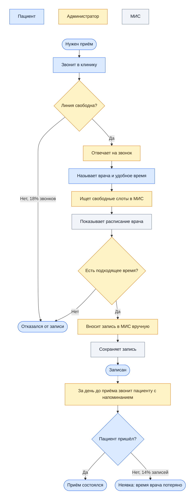
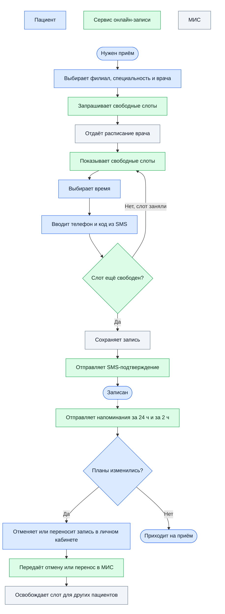
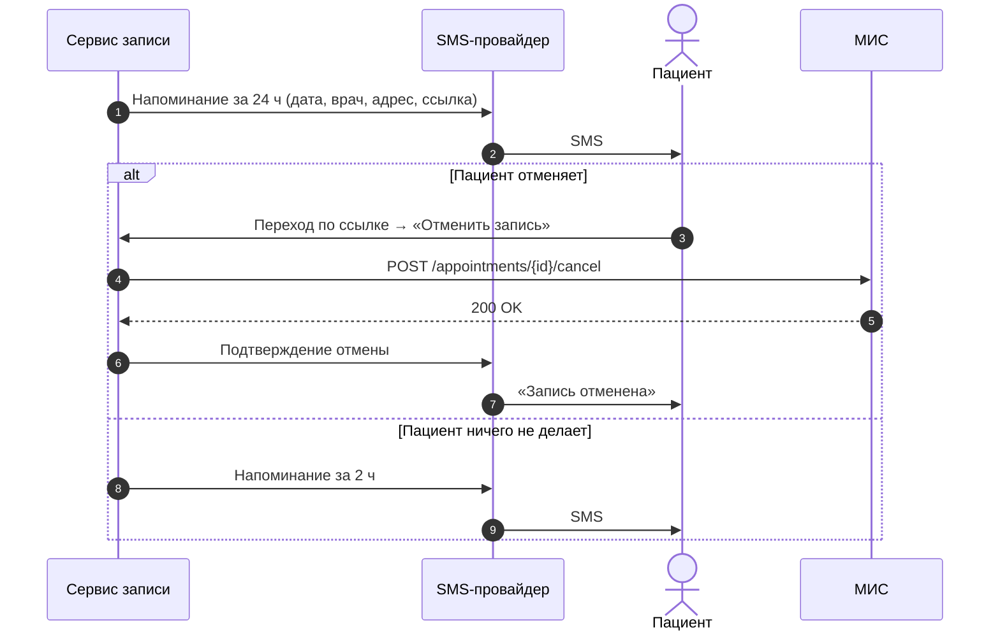

# 2. Процессы AS-IS и TO-BE

[← К оглавлению](../README.md)

Диаграммы построены по логике BPMN (участники, события, задачи, шлюзы) и записаны в Mermaid, чтобы GitHub отображал их прямо на странице. Обе схемы идут сверху вниз, а участник показан цветом блока. Легенда в верхней строке каждой схемы.

## AS-IS: запись по телефону

### Узкие места AS-IS

| # | Где | Что не так |
|---|---|---|
| 1 | «Линия свободна?» | Единственный канал записи, в часы пик пациент не может дозвониться |
| 2 | «Ищет свободные слоты» | Администратор подбирает время, пока пациент ждёт на линии |
| 3 | «Вносит запись вручную» | Риск ошибки: не тот врач, не то время |
| 4 | «Звонит с напоминанием» | Ручной труд, до части пациентов не дозвониться, отменённые слоты не освобождаются заранее |
| 5 | Вне рабочего времени | Процесс недоступен совсем |

## TO-BE: онлайн-запись

Как запись будет работать после внедрения. По этой схеме согласуем процесс с клиникой до того, как писать требования: из шагов пациента получаются user stories, из шагов сервиса — функциональные требования.

### Что изменилось

| Было (AS-IS) | Стало (TO-BE) | Какую проблему решает |
|---|---|---|
| Запись только по телефону в рабочие часы | Онлайн 24/7, телефон остаётся как запасной канал | P1, P5 |
| Администратор ищет слот при пациенте | Пациент сам видит свободные слоты | P2, P4 |
| Ручной ввод в МИС | Запись создаётся в МИС через API | P2 |
| Ручной обзвон | Автоматические SMS за 24 ч и за 2 ч со ссылкой на отмену | P3, P4 |
| Отменённый слот теряется | Отмена сразу освобождает слот для других | P3 |

## Процесс напоминания и отмены (подробно)

