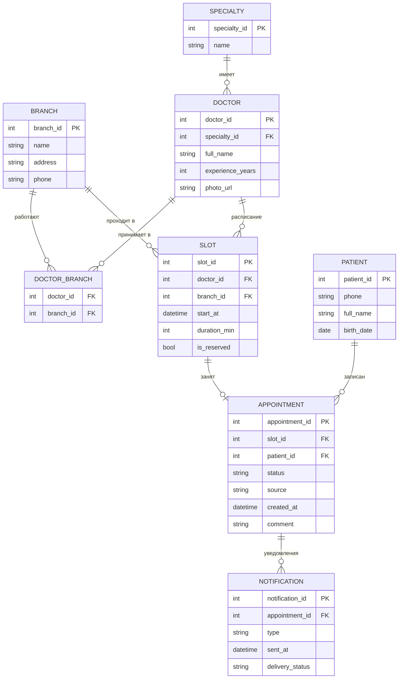
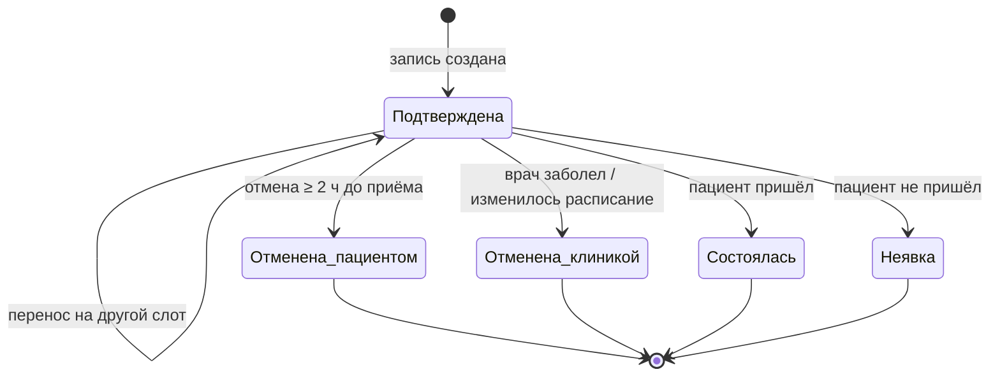

# 5. Модель данных и интеграция с МИС

[← К оглавлению](../README.md)

## Логическая модель данных



**Статусы записи (`APPOINTMENT.status`):**



При переносе новая запись не создаётся: у существующей меняется слот, статус остаётся «Подтверждена». История переносов пишется в журнал (NFR-07). Так у записи сохраняется комментарий пациента, а в отчётах один визит не считается дважды.

## Интеграция с МИС (REST API)

Своё расписание сервис записи не ведёт, главный источник данных о слотах — МИС. Слоты кэшируются не дольше минуты (FR-02), а перед созданием записи слот ещё раз проверяется в МИС (FR-04). Ниже методы, которые нужны от API МИС; список нужно согласовать с подрядчиком.

| Метод | Endpoint | Назначение | Требование |
|---|---|---|---|
| GET | `/branches` | Список филиалов | FR-01 |
| GET | `/doctors?branch_id=&specialty_id=` | Врачи по фильтру | FR-01 |
| GET | `/doctors/{id}/slots?date_from=&date_to=` | Свободные слоты врача | FR-02 |
| GET | `/patients?phone=` | Поиск пациента по телефону | FR-05 |
| POST | `/patients` | Создание карты пациента | FR-05 |
| POST | `/appointments` | Создание записи | FR-04, FR-10 |
| PATCH | `/appointments/{id}` | Перенос записи на другой слот | FR-08 |
| POST | `/appointments/{id}/cancel` | Отмена записи. Запись не удаляется, а получает статус «Отменена пациентом» | FR-08 |

### Пример: создание записи

**Запрос**

```http
POST /api/v1/appointments
Content-Type: application/json
```

```json
{
  "slot_id": 58213,
  "patient_id": 10442,
  "source": "online",
  "comment": "Первичный приём"
}
```

**Ответ 201 Created**

```json
{
  "appointment_id": 900125,
  "status": "confirmed",
  "doctor": { "doctor_id": 17, "full_name": "Иванова Анна Андреевна" },
  "branch": { "branch_id": 2, "address": "ул. Примерная, 10" },
  "start_at": "2026-10-15T10:30:00+03:00",
  "duration_min": 20
}
```

### Обработка ошибок

| Код | Ситуация | Что показать пациенту |
|---|---|---|
| 400 | Некорректные данные запроса | «Проверьте введённые данные» |
| 404 | Слот или пациент не найден | «Время больше недоступно, выберите другое» |
| 409 | Слот уже занят (конфликт) | «Это время уже заняли» + ближайшие слоты (исключение 14а в UC-01) |
| 422 | Нарушено бизнес-правило (например, лимит в 3 записи) | Текст правила |
| 503 | МИС недоступна | «Запись временно недоступна» + телефон филиала (NFR-06) |
